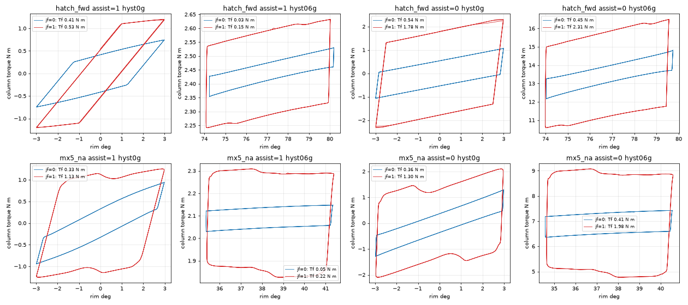

# Load-dependent joint friction (MB core)

Status: implemented, default on (`[car] joint_friction = 1`), solver 1 only. `joint_friction = 0` restores the
previous constant `rack_friction` / `column_friction` rows. The legacy core (solver 0) is unchanged.

## Model

Each friction joint is a box row (or an isotropic cone group) in the coupled multibody LCP. Its bound is
re-evaluated in every PGS sweep from the joint's **own constraint reactions in the same solve**:

    B = pre + sum_k c_k * max(0, |N_k| - d_k)        (impulse per substep)

* `pre` is the load-independent preload: seal drag, spring preload or ball-joint preload torque.
* `N_k` are reaction components of a parent joint, for example the ball-joint force or the rack guide side load.
* `c_k` is a coefficient times a lever, and `d_k` is a dead band, used e.g. for the yoke spring carrying separating force until it is overcome.

Friction is never applied as an external force. It is a constraint impulse inside the same solve, so Newton 3
holds at every joint, and dissipation is exactly the friction work: the energy ledger closes.

Ball joints have three rotational friction directions sharing one bound (an isotropic cone). They are solved as an
exact maximum-dissipation block projection (Moré–Sorensen Newton on the secular equation), not as three
independent boxes. Independent boxes would give an anisotropic square friction law.

| Joint | Rows | Bound (impulse / h) | Parameters (default) |
|---|---|---|---|
| Arm ball joints (lower/upper/links) | 3 rot. cone | `bj_torque + bj_mu*bj_radius*|F_bj|` | 0.08, 12.5 mm, 1.5 N m |
| Rack: seals + yoke + guide bushes | 1 transl. | `rack_friction + yoke_mu*yoke_preload + yoke_mu*max(0,mesh_sep*|F_t|-yoke_preload) + rack_bush_mu*|F_side| + 2 rack_bush_mu/span*|M_side|` | 60 N, 0.10, 800 N, 0.40, 0.12, 0.30 m |
| Column bearings | 1 rot. | `column_friction + brg_mu*r*|F_rad| + 2 brg_mu*r/span*|M|` | 0.15 N m, 0.002, 12 mm, 0.25 m |
| Pinion bearings | 1 rot. | `pin_torque + brg_mu*r*|F| + ...` | 0.05 N m, 10 mm, 0.06 m |
| Strut top mount (kingpin) | 1 rot. | `strut_mount_torque + strut_mount_mu*r*|F_axial|`, axial load = spring + bump stop | 0.5 N m, 0.004, 45 mm |
| Damper rod guide + piston | 1 transl. | `strut_seal + strut_mu*strut_lever*|F_side|` | 40 N, 0.07, 4.0 |

## Sources and estimates

* **Knapczyk J., Maniowski M. (2004).** Experimental rig study on resistance forces in car steering system with
  rack and pinion. *Archive of Mechanical Engineering* 51(2). Unassisted rack-and-pinion with MacPherson struts:
  friction at the handwheel comes roughly equally from the rack guide and the linkage ball joints. Because of the
  ball-joint and yoke preloads, total friction is only *moderately* load dependent. This sets the preload/load split
  and the structure (yoke dead band, ball-joint preload).
* **Gröndahl A. (2018).** *Functional Modelling and Simulation of an Electric Power Assisted Steering*, MSc thesis,
  Chalmers. Rack friction limit 210 N in a validated EPAS model, which includes the EPAS ball-screw/belt.
  For a manual or hydraulic rack the total rack friction (seals + yoke + bushes) should be below that.
  Our unloaded total is ~110–140 N and the loaded total ~150–175 N (table below).
* **Ball-joint preload:** workshop-manual rotation starting torque for passenger lower-arm ball joints,
  e.g. Mitsubishi Lancer/Outlander, 2.2–4.1 N m. Running torque is lower than breakaway, so `bj_torque` = 1.5 N m is
  an estimate of the running preload. `bj_mu` 0.08 is the steel ball on a greased PTFE/POM seat (boundary
  lubrication, 0.05–0.12). The ball radius is 12.5 mm (25 mm ball, passenger class).
* **Rolling bearings:** SKF simplified friction moment `M = 0.5 * mu * P * d` with mu ≈ 0.0015–0.002 for deep-groove
  and angular-contact ball bearings. Hence `brg_mu` = 0.002 with bore radius as the lever (as M = mu F d/2).
  Seal drag is folded into the preload terms (`column_friction`, `pin_torque`). The top-mount bearing (`strut_mount_mu`
  0.004) is a plain/ball thrust bearing with seals, so double the ball value: an estimate.
* **Rack yoke:** spring preload 800 N, steel on a PTFE-lined yoke (mu 0.10). The yoke only carries extra load once the
  gear separating force (≈ 0.40 × tangential tooth force for a ~20° pressure angle helical pinion with helix and
  friction) exceeds the spring preload. These are estimates consistent with manual-rack pinion turning torques of
  order 1 N m.
* **Damper:** rod guide/piston friction under strut side load. The side load at the guide is `strut_lever` × the top
  side load, from the guide/piston spacing vs strut length. 40 N seal drag is typical of twin-tube passenger dampers.
  Both are estimates.
* **Driver arm:** the hysteresis tests use the steering robot (stiff servo), not the driver model. For driving, the
  driver-wheel stiffness default is now 25 N m/rad. Xing Y. et al. (2018), IEEE/ASME Trans. Mechatronics,
  doi:10.1109/TMECH.2018.2812643, measured 10–46 N m/rad, rising to ~80 with co-contraction (cf. Pick & Cole 2007/08).

Not modelled (documented omissions): rack/pinion tooth sliding friction as a separate efficiency term (partly in the
yoke row), column U-joint friction, tie-rod inner/outer ball joints (they are pure distance constraints), and bushing
hysteresis (bushings are viscoelastic).

## Solver notes

* **Statically indeterminate friction.** Two stuck ball joints in one closed loop (e.g. lower and upper arm) admit a
  continuum of friction impulses that satisfy the same motion. The impulses are then non-unique and the PGS impulse
  residual never converges, although velocities do. PGS therefore stops when the impulse residual < 1e-12 **or** the
  velocity complementarity residual < `pgs_vtol` (1e-8 m/s or rad/s), with a 400-sweep cap. At most ~9 of 3000
  substeps hit the cap, ending at vres ~1e-6: physically negligible.
* **Cost.** About 750 µs per step vs ~340 µs with `joint_friction = 0` (mbcar rig, single core). The cost is
  dominated by the 28 extra K⁻¹Jᵀ solves of the friction rows. Optimisation (assembling the friction Schur block
  once per step) is an open item.
* Telemetry: `rack_fric` (N) and `col_fric` (N m) are the friction impulses / h of the current step (C and C# ABI),
  plus PGS sweep count and residuals.

## Validation: on-centre hysteresis, unloaded vs 0.6 g

Rig: `PSET="car.joint_friction=J;steer.assist=A" build/mbcompare cars/<car>.ini out 1 hyst`, then
`tools/plot_hyst.py root results/joint_friction/hyst_loops.png results/joint_friction/hyst_summary.csv`.

* 20 m/s, 3rd gear, steering robot (stiff angle servo).
* 3° rim sine at 0.1 Hz about the straight-ahead or about the rim angle trimmed for a steady 0.6 g turn
  (ay integral trim for 25 s, hold to 30 s).
* One run-in cycle, then three fitted cycles.
* Rim friction is half the loop width of column torque at the mean rim angle, (T_up − T_down)/2.

| car | assist | case | rim friction jf=0 (N m) | jf=1 (N m) | rack friction jf=0 (N) | jf=1 (N) |
|---|---|---|---|---|---|---|
| mx5_na | on | 0 g | 0.33 | 1.13 | 56 | 131 |
| mx5_na | on | 0.6 g | 0.05 | 0.22 | 59 | 153 |
| mx5_na | off | 0 g | 0.36 | 1.30 | 59 | 140 |
| mx5_na | off | 0.6 g | 0.41 | 1.98 | 59 | 153 |
| hatch_fwd | on | 0 g | 0.41 | 0.53 | 51 | 109 |
| hatch_fwd | on | 0.6 g | 0.03 | 0.15 | 59 | 175 |
| hatch_fwd | off | 0 g | 0.54 | 1.78 | 58 | 135 |
| hatch_fwd | off | 0.6 g | 0.45 | 2.31 | 58 | 172 |

Findings:

1. **Friction grows with load.** At the source (rack friction), it rises 10–60 % from straight-ahead to 0.6 g with
   jf=1 and stays flat with jf=0. With a manual rack (assist off), rim friction grows +52 % (mx5) and +30 % (hatch).
   This is the "moderate" load dependence Knapczyk & Maniowski report, dominated by the preloads.
2. **Column friction stays at ~0.15 N m.** Column bearing radial loads are small, so the column is effectively preload only.
3. **HPAS hides friction off-centre.** With the rotary valve open at 0.6 g, the hydraulic boost carries rack and
   kingpin friction, so the friction felt at the rim drops to 0.15–0.22 N m although the source friction rose.
   On centre the valve is closed and the driver feels it all. This is the classic "on-centre friction feel" of
   hydraulic racks (Norman, SAE 840069, on-centre handling metrics). It is emergent from the coupled solve, not tuned.
4. The rim friction of 1.1–1.3 N m on centre (jf=1) is the size Norman's on-centre test calls Coulomb
   friction (torque at 0 g). jf=0 gave only ~0.35 N m, too little for a 1990s rack.

Driving validation: closed-loop laps with the path driver (arm stiffness 25 N m/rad) with jf=1 on both cars show
no instability, no spin and lap times unchanged vs jf=0 within run-to-run scatter.
